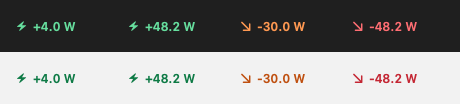
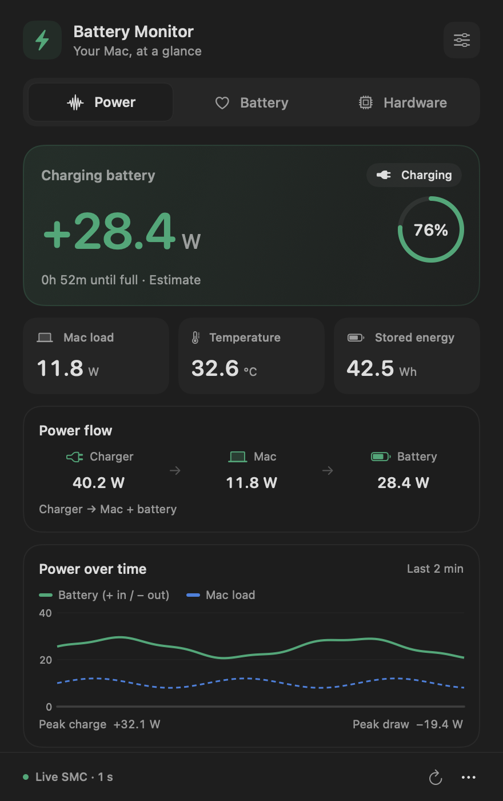
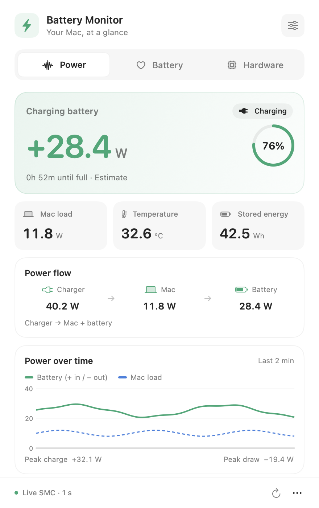

# Battery Monitor

A native macOS menu bar app for seeing how much power your Mac is using, how quickly its battery is charging, and what its battery health looks like.

Built with SwiftUI, AppKit, Swift Charts, and IOKit. The menu bar shows signed battery wattage by default, with a detailed dashboard one click away.



## Preview

<p>
  
  
</p>

Screenshots use illustrative data. More previews are available in [Preview](Preview/).

## Features

- **Live battery power:** signed wattage, sampled approximately once per second when supported SMC sensors are available.
- **Saved preferences:** menu bar appearance, alerts, glow, and thresholds survive app restarts.
- **Menu bar display options:** battery watts, charger input, system load, battery percentage, and temperature.
- **Local history:** seven days of minute averages for power, charge level, and battery temperature, with 1-hour, 24-hour, and 7-day views. Recent session summaries survive restarts.
- **Power dashboard:** charging status, battery level, temperature, stored energy, power flow, and a rolling two-minute chart.
- **Battery temperature:** read-only SMC battery hotspot sensor (`TB0T`, or the highest available `TB1T`/`TB2T` reading) with registry fallback; unavailable readings remain clearly marked.
- **Battery session summaries:** observed time, percentage-point drop, time-weighted average draw, energy used, and measurement coverage. Sleep and monitoring gaps start a fresh observed session.
- **Battery health:** raw and smoothed capacity, charge cycles, charge-rate estimates, and cell voltages when exposed by the hardware.
- **Hardware details:** adapter rating, voltage/current, battery controller information, and available lifetime records.
- **Custom alerts:** low-battery and charge-target notifications, with an optional screen-edge glow.
- **Raw data inspector:** searchable battery registry keys and values.
- **Power-change handling:** refreshes on power-source notifications and reconnects live sensors after wake.
- **Native appearance:** light and dark modes, with a menu bar-only interface and no Dock icon.

## Reading the watts

| Reading | Meaning |
| --- | --- |
| `+28.4 W` battery power | Power flowing into the battery |
| `−12.0 W` battery power | Power being supplied by the battery |
| Charger input | Power delivered to the Mac, including both battery charging and system consumption |
| Mac load | Whole-system consumption, measured or derived from the available telemetry |

Charging stays green at every speed. Charger input is blue. For battery drain and system load, the color scale is green below 10 W, amber from 10 to under 20 W, orange from 20 to under 40 W, and red at 40 W or more. These colors indicate power intensity, not battery damage.

The adapter's rated wattage is its capacity; it is not the same as the power currently being delivered.

## Requirements

- **macOS 27.0 or later**, as currently configured in the Xcode project.
- **Xcode 27 or later** for the current project configuration.
- A Mac with a built-in battery. Live SMC readings have been verified on an Apple silicon MacBook; availability on other hardware can vary.

There are no third-party package dependencies.

## Build and run

1. Clone the repository and open `battery stuff.xcodeproj` in Xcode.
2. Select the **battery stuff** scheme and **My Mac** as the run destination.
3. Configure local signing in **Signing & Capabilities** if Xcode requests it.
4. Press **⌘R**. The app appears in the menu bar.
5. Allow notifications if you want threshold alerts. Open the top-right settings control in the dropdown to customize the display and alerts.

You can also build from the repository directory:

```sh
xcodebuild \
  -project "battery stuff.xcodeproj" \
  -scheme "battery stuff" \
  -configuration Release \
  -destination 'platform=macOS' \
  -derivedDataPath build \
  build
```

The app bundle will be at `build/Build/Products/Release/battery stuff.app`.

### Run independently of your editor

In Xcode, find the built app under **Products** and choose **Show in Finder**. Copy `battery stuff.app` into **Applications**, then launch that copy directly. It will keep running when you close your editor.

To start automatically, add the app under **Open at Login** in System Settings' Login Items settings. Closing the dropdown keeps monitoring active; choose **Quit Battery Monitor** from the footer's more-options menu to stop it.

## How telemetry works

| Source | Used for |
| --- | --- |
| Read-only SMC sensors (`B0AV`, `B0AC`, `PDTR`) | Battery voltage, current, and charger input |
| IOPowerSources | Charging/power-source status, displayed percentage, and time estimates |
| AppleSmartBattery registry | Capacity, health, temperature, adapter details, and fallback power readings |

Battery power is calculated from live voltage × current when SMC readings are available. Otherwise, the app falls back to registry telemetry, which can refresh much more slowly. The dashboard footer identifies the active source. Missing or inconsistent battery power readings display as `—` rather than being presented as a fresh measurement.

The app remains sandboxed and includes an IOKit user-client exception for SMC access. Its SMC reader only reads sensors; it does not write hardware settings.

## Regression checks

Run all local regression checks from the repository directory:

```sh
./scripts/check.sh
```

These checks cover telemetry and temperature decoding, preference persistence, session integration, measurement gaps, history retention, archive corruption, write ordering, and status-icon rendering under repeated appearance notifications. Physical plug/unplug and sleep/wake behavior should also be checked with the app running.

## Project structure

```text
battery stuff/
├── BatteryMonitorApp.swift       # App entry point and lifecycle
├── BatteryStatusController.swift # Native status button; dashboard exists only while open
├── BatteryStatusButtonRenderer.swift # Deduplicated status button updates
├── PowerMenuBarLabel.swift       # Eager bitmap wattage rendering
├── BatterySnapshot.swift         # Telemetry models
├── BatteryService.swift          # Monitoring, telemetry, history, and alerts
├── BatteryPreferences.swift     # Saved menu bar and alert preferences
├── BatterySessions.swift        # Observed sessions and measured energy
├── BatteryHistory.swift         # Minute aggregation and local archive
├── BatteryHistoryView.swift     # Power, charge, and temperature timelines
├── SMCPowerReader.swift          # Read-only live sensor access
├── PowerTelemetry.swift          # Signed-value decoding and validation
├── JuicyMenuView.swift           # Dashboard, settings, and inspector
└── BatteryMonitor.entitlements   # Sandbox and SMC access configuration
Tests/                           # Telemetry regression checks
Preview/                         # Native UI renders using illustrative data
battery stuff.xcodeproj/          # Xcode project
```

## Current scope

This version is a monitoring tool. It does not automatically optimize other apps, limit charging, change CPU/GPU power settings, or guarantee longer battery life. Charge targets trigger alerts; they do not stop charging.

Hardware telemetry is model-dependent. Energy, health, charge-rate, and remaining-time values should be treated as estimates. Display preferences and alert settings are saved locally. History and up to 50 recent battery session summaries are stored for seven days in the app’s Application Support directory. Battery readings stay local; the app contains no network requests or analytics.

## Sessions and local history

The Power tab shows the current battery session, or the last completed session when connected to power. A session begins when an unplug event is observed, or when the app starts monitoring an already unplugged Mac. It reports observed time, percentage points used, time-weighted average draw, and measured watt-hours. Average draw uses valid consecutive samples; measurement coverage shows how much observed time those samples cover.

The History tab stores minute averages and offers 1-hour, 24-hour, and 7-day timelines. Longer ranges combine averages using sample counts. Power-source changes, missing sensors, sleep, and app restarts create separate chart segments. Sleep, app downtime, and sampling gaps longer than 15 seconds are not included in energy totals. New sessions start after these interruptions because the app cannot know whether the charger changed while monitoring was paused.

History is local JSON under the sandboxed app's `Application Support/BatteryMonitor/history-v1.json`. It contains numeric readings, timestamps, random chart/session IDs, and battery session summaries; it does not store serial numbers or raw registry data. Writes run on a background queue about once a minute and on session changes. Normal quit and sleep flush pending data; a force quit or crash can lose the last minute. Corrupt or unsupported history is reported and preserved until you choose **Settings → Clear local history**. Clearing history keeps appearance and alert preferences.

The live two-minute chart and its peak values cover the current app run; persisted charts show averages rather than individual one-second peaks. No readings are reconstructed while the app is closed.
